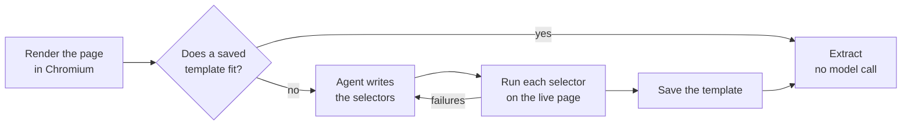

<h1 align="center">turbo-crawl</h1>

<p align="center"><strong>Turn any web page into structured JSON, without writing selectors.</strong></p>

<p align="center">
  <a href="https://www.npmjs.com/package/@fragmentoid/turbo-crawl"></a>
  <a href="https://github.com/dannycalleri/turbo-crawl/actions/workflows/release.yml"></a>
  <a href="https://www.npmjs.com/package/@fragmentoid/turbo-crawl"></a>
  
  
  <a href="LICENSE"></a>
</p>

<p align="center">
  <a href="#get-started">Get started</a> ·
  <a href="#examples">Examples</a> ·
  <a href="docs/reference.md">Reference</a> ·
  <a href="docs/upgrading.md">Upgrading</a> ·
  <a href="CHANGELOG.md">Changelog</a>
</p>

The first time turbo-crawl sees a page layout, it asks a coding agent you already use (**Claude Code** or **Codex**) to write an extraction template: CSS, JSON-LD, meta or table selectors for each field. Every selector is checked on the live page, and the ones that fail go back to the agent to fix. After that, every page with the same layout is read with the saved template, with **no model call**.

## Get started

You need Node.js 20 or later, and one template author, installed and logged in: [Claude Code](https://docs.claude.com/en/docs/claude-code) (`claude`, the default) or the [Codex CLI](https://github.com/openai/codex) (`codex`). A local [LM Studio](https://lmstudio.ai) server works too, with `--provider lmstudio`. The agent is needed only where a template is written.

Run turbo-crawl with `npx`. On the first run, it downloads Chromium for Playwright (about 100 MB, one time) and shows the progress.

Crawl a product page and name the fields you want:

```console
$ npx @fragmentoid/turbo-crawl crawl https://bookshop.example/catalogue/a-light-in-the-attic_1000/index.html \
    --fields title:string,price:number,availability:string,upc:string
Rendering https://bookshop.example/catalogue/a-light-in-the-attic_1000/index.html…
Using claude to write the template.
Asking claude to write selectors for 4 fields…
{
  "ok": true,
  "kind": "item",
  "urlPattern": "/catalogue/:slug/index.html",
  "path": "authored",
  "llmUsed": true,
  "data": {
    "title": "A Light in the Attic",
    "price": 51.77,
    "availability": "In stock (22 available)",
    "upc": "a897fe39b1053632"
  },
  ...
}
```

Crawl another page with the same layout. The saved template reads it, and no model is called:

```console
$ npx @fragmentoid/turbo-crawl crawl https://bookshop.example/catalogue/sapiens-a-brief-history-of-humankind_996/index.html
Extracted with the saved template data/bookshop.example/templates/dc69babc39c9291d.json.
{
  "ok": true,
  "kind": "item",
  "path": "template-reuse",
  "llmUsed": false,
  "data": { "title": "Sapiens: A Brief History of Humankind", "price": 54.23, ... }
}
```

### Install it globally (optional)

To type `turbo-crawl` instead of `npx @fragmentoid/turbo-crawl`, install the package:

```sh
npm install -g @fragmentoid/turbo-crawl
turbo-crawl crawl <url> --fields title:string
```

## Why turbo-crawl

| You get | In practice |
|---|---|
| **One model call per layout** | The agent writes a template once. Every later page with that layout is read with no model call. |
| **No selectors to write** | Name the fields, or let the agent suggest them. turbo-crawl tests each selector on the live page. |
| **New URLs are no problem** | A template is matched by what the page contains, not by its URL. |
| **You know when a site changes** | When a known page stops fitting its template, the result is marked `stale`. |
| **Whole listings** | Give it a category or search page. It extracts every item and follows the next pages. |
| **Spec sheets that vary** | A `pairs` field reads every label/value row of a table or list, also rows the template never saw. |
| **The agent you already use** | Claude Code or Codex, with your own login. No API keys, and the agent never sees your files. |
| **Your user agent, your rules** | Set your own with `--user-agent`, a [config file](docs/reference.md#user-agent) or the library option. robots.txt is respected by default. |
| **No model in production** | Templates are plain JSON. Commit them and extract in CI with no agent. |
| **Fits your server** | Bring your own HTML, model client and template storage. The library adds no SDK dependency. |

## Examples

**Let the agent choose the fields.** Leave out `--fields`, and the agent suggests the fields for the page:

```sh
npx @fragmentoid/turbo-crawl crawl https://news.example/2026/11/04/clock-3
```

**Crawl a listing.** Every item of a category page, following its next pages, as NDJSON:

```console
$ npx @fragmentoid/turbo-crawl crawl https://bookshop.example/catalogue/category/books/mystery_3/index.html \
    --fields title:string,price:number --max-items 25 > books.ndjson
Crawled 2 listing page(s): 25 item(s) extracted, 0 failed.

$ head -1 books.ndjson
{"ok":true,"kind":"item","url":"https://bookshop.example/catalogue/sharp-objects_997/index.html","data":{"title":"Sharp Objects","price":47.82},...}
```

**Read every spec row.** A `pairs` field points at the table, not at one row. The template from a page with 3 rows reads all 5 rows of the next page:

```console
$ npx @fragmentoid/turbo-crawl crawl https://shop.example/omega/seamaster--id51234567.htm --fields price:number,specs:pairs
{
  "ok": true,
  "data": {
    "price": 4200,
    "specs": { "Brand": "Omega", "Model": "Seamaster", "Reference": "210.30", "Lug width": "20 mm", "Case": "42 mm" }
  },
  ...
}
```

**Never call a model.** With `--no-author`, only saved templates are used. When none fits, the CLI exits 3:

```sh
npx @fragmentoid/turbo-crawl crawl https://bookshop.example/catalogue/sharp-objects_997/index.html --no-author --data-dir templates
```

**Use it from Node.** Author templates on your machine, commit them, and extract in CI with `authoring: "never"`:

```ts
import { createCrawler } from "@fragmentoid/turbo-crawl";

const crawler = createCrawler({
  dataDir: "templates",                                  // templates you authored and committed
  userAgent: "MyBot/1.0 (+https://example.com/bot)",     // required, no default
  authoring: "never",                                    // never start an agent
});

const index = await crawler.links("https://news.example/archive");
if (index.ok) {
  for (const item of index.itemUrls) {
    const article = await crawler.extract(item.url, { require: ["headline", "body"] });
    if (article.ok) console.log(article.canonicalUrl, article.data);
    else console.error(article.code, article.message);
  }
}

await crawler.close();
```

**Read HTML that you rendered.** When your own browser or render service already has the page, give the HTML to `extractHtml`. turbo-crawl sends no request and does not read robots.txt:

```ts
const item = await crawler.extractHtml({
  url: "https://shop.example/item/42",
  html,                                                  // HTML from your own renderer
  require: ["price"],
});
```

**Run it on a server.** Use your own model client for the agent calls, and keep the templates in your own storage, for example a database table:

```ts
const crawler = createCrawler({
  userAgent: "MyBot/1.0 (+https://example.com/bot)",
  authoring: "allowed",
  provider: { name: "gateway", completeStructured },     // your client: { model, messages, jsonSchema, signal } → { parsed, raw }
  model: "provider/model-id",
  store,                                                 // listTemplates, saveTemplate, updateTemplate, ... (no dataDir needed)
});
```

Install it in a project with `npm install @fragmentoid/turbo-crawl playwright`.

## How it works



The [reference](docs/reference.md#how-it-works) has the details of each step.

## Documentation

- [Reference](docs/reference.md): every CLI option, exit codes, `pairs` fields, listing pages, how turbo-crawl selects a template, URL patterns, user agent, robots.txt, environment variables, the library API (including your own model client and template store) and the data layout.
- [Upgrading](docs/upgrading.md): what changed in 0.2, 0.4 and 0.5.
- [Changelog](CHANGELOG.md).

## Contributing

```sh
bun install
bun run dev crawl <url>   # run from source
bun run typecheck
bun run test              # plain, browser and e2e tests
bun run build             # dist/cli.js and dist/lib.js, run on Node
```

See [AGENTS.md](AGENTS.md) for conventions. Commits follow Conventional Commits. Every merge to `main` updates a release pull request built by [release-please](https://github.com/googleapis/release-please); merging it publishes the package to npm with provenance.

## License

[MIT](LICENSE)
